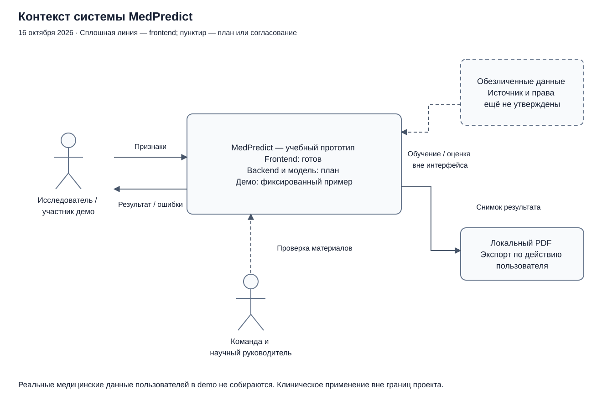
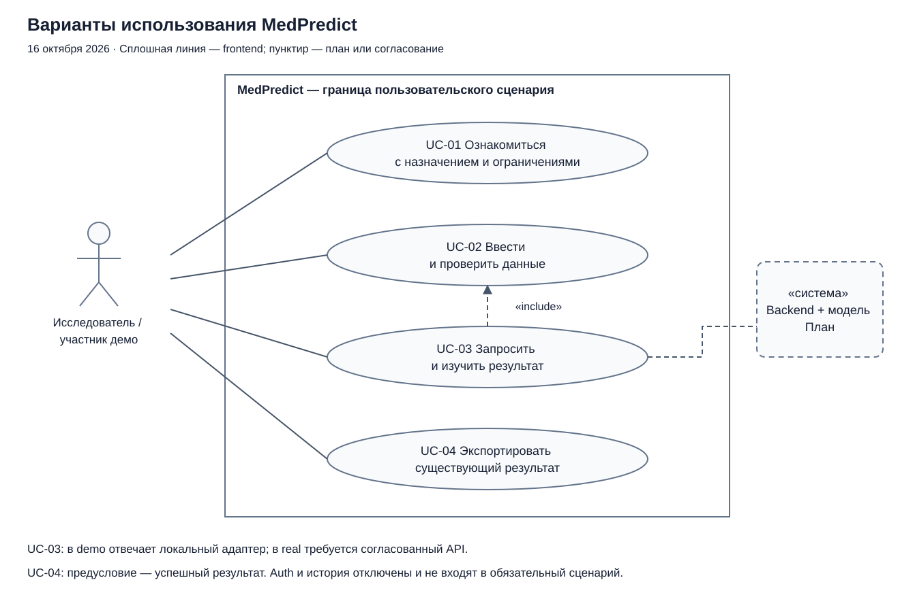
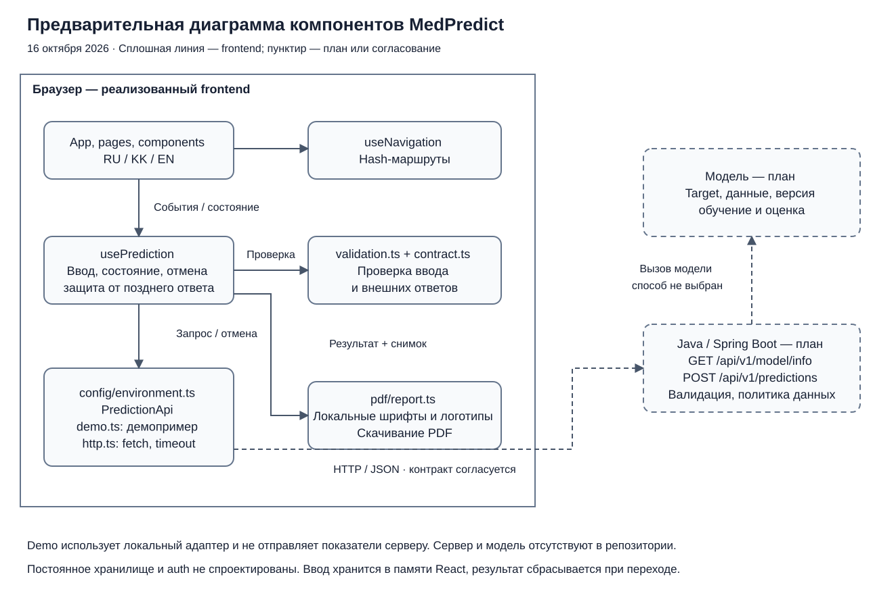

# Архитектура MedPredict

Версия от 16 октября 2026. Диаграммы показывают существующий frontend и предварительные границы будущей интеграции. Backend и модель отсутствуют в этом репозитории; внутренняя организация сервера и способ исполнения модели не утверждены. База данных, auth и постоянная история не добавляются в архитектуру как готовые компоненты.

## Контекст системы

Исследователь или участник демонстрации вводит синтетические признаки и получает результат либо сообщение об ошибке. В demo ответ выдаёт локальный адаптер; real должен обращаться к серверу. Обучение и оценка используют отдельный согласованный обезличенный датасет, а не данные посетителей demo. PDF создаётся в браузере по явному действию пользователя. Команда и руководитель проверяют материалы, но не являются скрытыми операторами обработки запросов.

[Редактируемый источник контекста](diagrams/context.drawio) · [SVG для просмотра](diagrams/context.svg).

## Варианты использования

Основной актор — исследователь/участник демо. UC-01 объясняет назначение и ограничения; UC-02 позволяет ввести и проверить данные; UC-03 запрашивает и показывает ответ, включая проверку UC-02 при отправке; UC-04 экспортирует уже полученный результат. Предусловие UC-04 — успешный ответ; он не вызывает новое предсказание.

Для этой диаграммы граница — пользовательский сценарий frontend. В real внешний сервис прогноза участвует в UC-03; описание модели загружается до доступности формы. Auth и история доступны как отключённые интерфейсы и не считаются завершёнными вариантами использования. Связи с FR/NFR приведены в [спецификации](requirements.md).

[Редактируемый источник Use Case](diagrams/use-cases.drawio) · [SVG для просмотра](diagrams/use-cases.svg).

## Компоненты и данные

| Компонент | Ответственность | Граница / данные |
|---|---|---|
| `App`, `pages`, `components`, `i18n` | Страницы, локализация, доступные поля, сообщения и результат | React; ввод/язык в памяти, значения не включаются в hash |
| `useNavigation` | Hash-навигация и отмена текущего сценария при переходе | Переход сохраняет ввод, сбрасывает результат |
| `usePrediction` | Метаданные, ввод, проверка, запрос, ошибка/успех, отмена и защита от поздних ответов | Не более одного активного POST; снимок проверенного ввода у результата |
| `validation.ts`, `api/contract.ts` | Проверка формы и внешних структур | JSON считается недоверенным до проверки; диапазоны только из конфигурации |
| `config/environment.ts`, `PredictionApi`, `api/demo.ts`, `api/http.ts` | Явный выбор адаптера, фиксированное demo либо HTTP | Два метода: `getModelInfo` и `predict`; нет скрытого fallback |
| `pdf/report.ts` | Текстовый PDF из существующего результата и снимка запроса | Локальные ресурсы, без повторного POST; документ содержит экспортированные показатели |
| Java/Spring Boot — план | Независимая валидация, ответ модели, ошибки и политика обработки | Контракт, CORS, хранение/логи и эксплуатация ещё согласуются |
| Модель — план | Обучение/оценка и предсказание утверждённого target | Формат артефакта, версия, признаки и способ вызова ещё не определены |

Стрелки компонентов обозначают основную передачу управления/данных, а не все TypeScript-импорты. PDF получает снимок через страницу прогноза; `usePrediction` не импортирует генератор PDF. Пунктир означает планируемую или согласуемую интеграцию; сплошные границы соответствуют реализованному frontend.

[Редактируемый источник компонентов](diagrams/components.drawio) · [SVG для просмотра](diagrams/components.svg).

## Последовательность real-сценария

1. Frontend проверяет режим окружения и запрашивает `GET /api/v1/model/info`.
2. `parseModelInfo` проверяет описание; только после успеха форма доступна. Пользователь заполняет поля, заданные метаданными.
3. `validateInput` преобразует значения; при ошибке POST не выполняется, фокус получает первое проблемное поле.
4. Явная отправка вызывает `POST /api/v1/predictions`. Таймаут и пользовательская отмена прекращают ожидание клиента; прекращение вычисления на сервере этим не гарантируется.
5. Структура и единицы ответа проверяются до показа. Поздний ответ отменённого запроса игнорируется.
6. Экспорт использует существующий ответ и сохранённый снимок отправленного ввода. Изменение ввода или переход скрывают прежний результат.

Точный формат — в [предварительном API-контракте](api-contract.md). GET остаётся предложением frontend; этот пакет не меняет договорённость с backend и не расширяет API.

## Границы доверия и открытые решения

Браузер не является местом хранения секретов: `VITE_*` попадает в клиентскую сборку. Сервер независимо проверяет данные. Demo не отправляет показатели по сети; real отправляет их настроенному серверу, поэтому политика backend требует отдельной проверки. На frontend нет постоянного хранения показателей; экспортированный PDF остаётся ответственностью пользователя.

Нужно согласовать target/популяцию/горизонт и признаки; GET/POST/400 и версии; способ вызова модели; CORS/TLS; доступ, логи, хранение и удаление. Эти решения отражены в [реестре задач](planning/tasks.csv) и [рисках](project-management.md). Ни отдельный inference-микросервис, ни СУБД пока не обязательны.

## Работа с исходниками диаграмм

Файлы `.drawio` содержат несжатый XML и открываются в совместимом редакторе diagrams.net, включая desktop-версию. `.svg` предназначены для просмотра в репозитории и презентации. После изменения `.drawio` повторно экспортировать соответствующий SVG и проверить подписи, стрелки и различие готовых/планируемых компонентов. Исходники и изображения версионировать вместе. При подготовке текущей версии все три SVG отрисованы и просмотрены; XML-структура и ссылки проверены.
