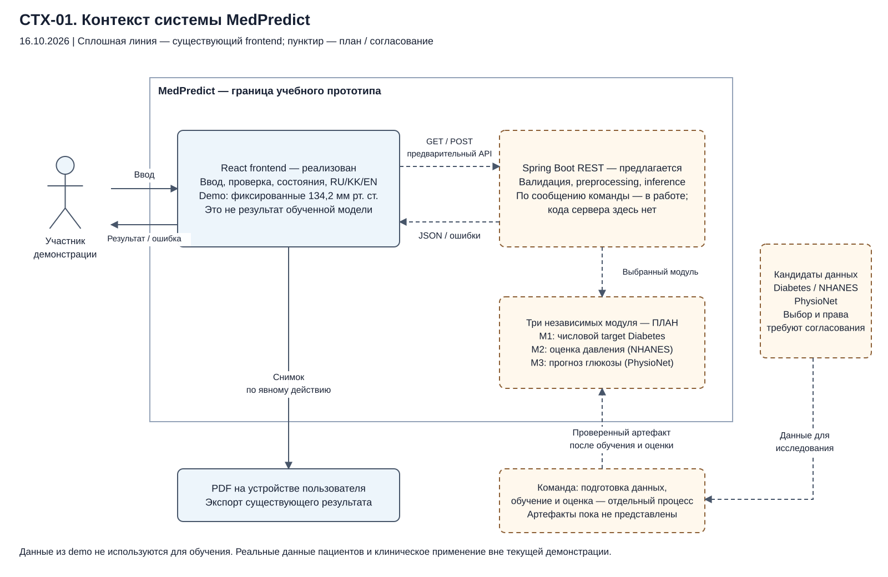
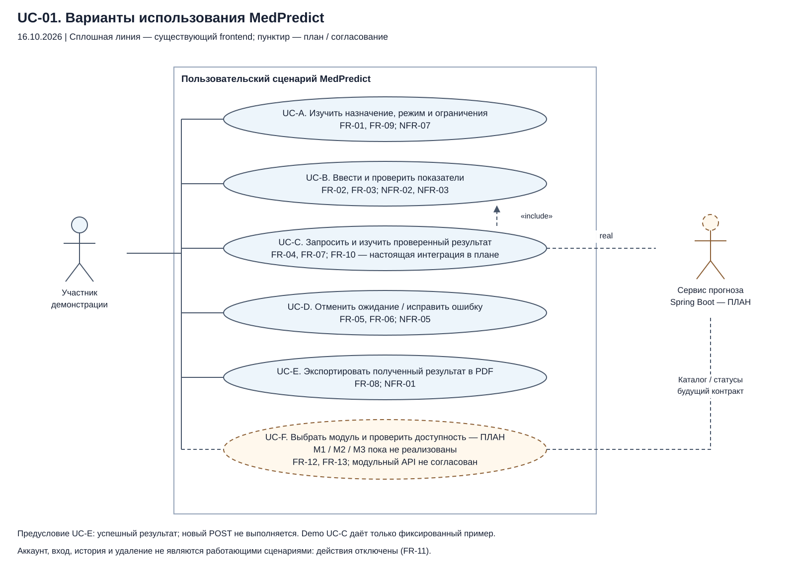
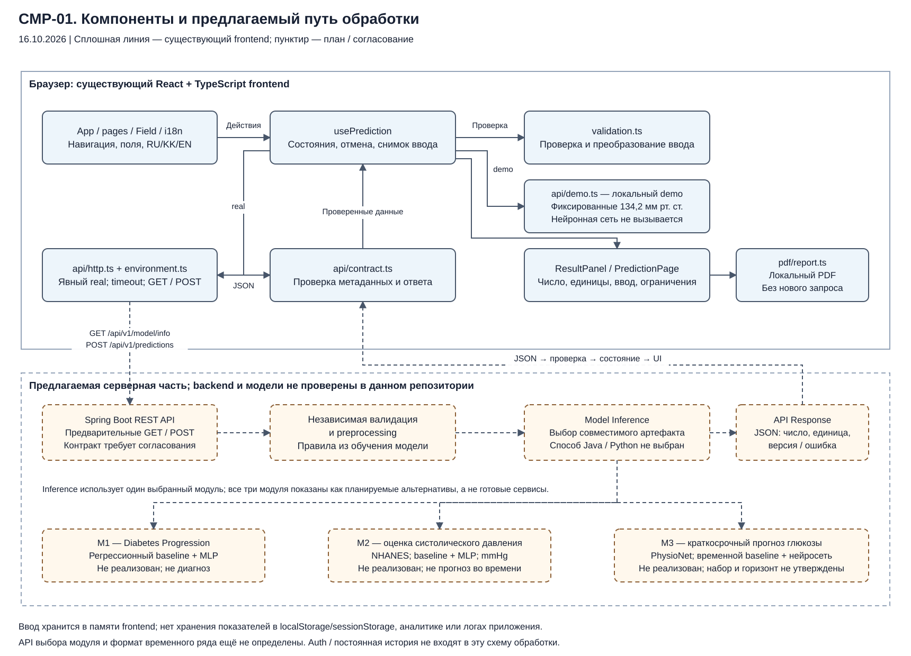

# Архитектура и обязательные диаграммы MedPredict

Версия 1.0 для первой предзащиты 24 октября 2026 года. Дата подготовки: 16 октября 2026 года. Статус: описание подтверждённого frontend и предлагаемой целевой архитектуры; серверные решения требуют согласования.

**Официальная тема:** «Разработка интеллектуальной системы прогнозирования медицинских показателей на основе нейронных сетей».

## 1. Архитектурная позиция и доказательства

MedPredict рассматривается как учебный исследовательский веб-прототип с потенциально тремя независимыми задачами оценки/прогнозирования числовых показателей. Репозиторий содержит реализованный React + TypeScript + Vite frontend. В нём есть локальный демонстрационный адаптер и HTTP-адаптер. Demo возвращает фиксированные **134,2 мм рт. ст.** независимо от ввода и не вызывает обученную модель. Наличие HTTP-клиента и тестовых ответов не доказывает готовность настоящей интеграции.

По сообщению команды Java/Spring Boot backend находится в разработке. Его исходников, обученных модельных артефактов и результатов экспериментальной оценки в данном репозитории не представлено. Поэтому серверные компоненты, preprocessing, inference и M1/M2/M3 показаны как предлагаемые. Внутренние пакеты Java, СУБД, очередь и отдельный Python-микросервис не объявляются существующими.

Источники фактов: [предоставленные требования университета](../pre-defense/evidence/university-requirements-extract.md), `AGENTS.md`, `src/types.ts`, `src/App.tsx`, `src/hooks/usePrediction.ts`, `src/hooks/useNavigation.ts`, `src/config/`, `src/api/`, `src/pages/`, `src/components/`, `src/pdf/report.ts`, существующий [предварительный API-контракт](../api-contract.md) и тесты. Новая [спецификация требований](../requirements/MedPredict_Requirements_Specification.md) задаёт FR-01…FR-13 и NFR-01…NFR-09. Сохранённые `docs/architecture.md` и `docs/diagrams/` не заменены.

## 2. Диаграмма контекста CTX-01

*Рисунок 1 — Контекст существующего frontend и предлагаемой серверной части MedPredict, состояние на 16.10.2026.*

[Редактируемый источник](diagrams/context.drawio) · [SVG](diagrams/context.svg) · [PNG для Word/презентации](diagrams/context.png).

Пользователь взаимодействует с браузерным прототипом: вводит синтетические примеры, видит состояние, результат или ошибку, при необходимости экспортирует PDF. В demo вычисления модели и передача показателей серверу отсутствуют. В real клиент должен обращаться только к явно настроенному API, однако настоящая интеграция ещё не подтверждена.

Граница системы включает существующий frontend и предлагаемую серверную часть. Данные-кандидаты и процесс обучения находятся вне пользовательского пути. Источники и права использования данных, правила отбора и модельные артефакты подлежат утверждению. Пользовательский ввод из demo не является обучающим набором. Локальный PDF — отдельный экспортируемый документ, который может содержать введённые показатели и остаётся на устройстве пользователя по его действию.

Требования: FR-01, FR-04, FR-07, FR-08, FR-10, FR-12, FR-13; NFR-01, NFR-07, NFR-08.

## 3. Диаграмма вариантов использования UC-01

*Рисунок 2 — Основные пользовательские сценарии и отдельно обозначенный будущий выбор модуля.*

[Редактируемый источник](diagrams/use-cases.drawio) · [SVG](diagrams/use-cases.svg) · [PNG](diagrams/use-cases.png).

В этой диаграмме граница обозначает пользовательский сценарий frontend; внешний сервис прогноза — поддерживающий актор real-режима. Реализованные интерфейсные сценарии и предлагаемые серверные возможности не смешиваются. Штриховая зависимость «include» следует нотации UML и обозначает обязательную проверку ввода при запросе, а не незавершённость самой клиентской валидации. Пунктирные рамки и остальные пунктирные связи обозначают планируемые/согласуемые элементы.

| Сценарий | Предусловие и основной поток | Альтернативы / состояние | Требования |
|---|---|---|---|
| UC-A. Изучить назначение и ограничения | Открыта главная или информационная страница; пользователь видит режим и ограничения, выбирает язык | Клиентские тексты реализованы; пользовательская валидация полезности не подтверждена | FR-01, FR-09; NFR-07 |
| UC-B. Ввести и проверить показатели | В demo доступны локальные метаданные, в real нужен валидный GET; пользователь заполняет поля; проверка выполняется перед отправкой | Ошибка остаётся связанной с полем; медицинские диапазоны самостоятельно не вводятся | FR-02, FR-03; NFR-02, NFR-03 |
| UC-C. Запросить и изучить результат | Валидный ввод; явная отправка; ожидание; проверка структуры и единицы; число и контекст на экране | Demo — фиксированный пример; настоящий backend/модель — план; некорректный ответ отвергается | FR-04, FR-07, FR-10; NFR-05 |
| UC-D. Отменить или исправить | Есть ожидающий запрос либо ошибка; пользователь отменяет или редактирует | Поздний ответ игнорируется; ввод остаётся в памяти; скрытого повтора и fallback нет | FR-05, FR-06; NFR-05 |
| UC-E. Экспортировать PDF | Уже есть проверенный успешный результат; пользователь инициирует экспорт | Нет нового POST; ошибка ресурсов допускает повтор | FR-08; NFR-01 |
| UC-F. Выбрать модуль и проверить доступность | Будущий согласованный каталог/статусы модулей | M1/M2/M3 не реализованы; API и изменение UI пока не выполнены | FR-12, FR-13 |

Auth, аккаунт, история и удаление представлены только страницами с отключёнными действиями. Они не включены в работающие сценарии. Поля паролей также отключены; успешный вход, сохранение и удаление не имитируются (FR-11).

Старые UC-01…UC-04 сохранённой спецификации соответствуют UC-A, UC-B, UC-C/UC-D и UC-E. Новые буквенные метки позволяют отличать сценарии от идентификатора самой диаграммы UC-01.

## 4. Диаграмма компонентов CMP-01

*Рисунок 3 — Реализованные клиентские компоненты и предлагаемый pipeline Spring Boot, preprocessing, inference, API response и интерфейс результата.*

[Редактируемый источник](diagrams/components.drawio) · [SVG](diagrams/components.svg) · [PNG](diagrams/components.png).

Стрелки отражают основные вызовы и передачу данных, а не полный граф импортов TypeScript и не порядок сетевых пакетов. Формирование результата происходит через состояние `usePrediction`; проверка ответа применяется и в demo. `PredictionPage` передаёт сохранённый результат в PDF-генератор; сам hook генератор не импортирует.

### 4.1. Реализованные компоненты

| Компонент | Ответственность | Данные / ограничения | Требования |
|---|---|---|---|
| `App`, `pages`, `components`, `i18n` | Страницы, поля, сообщения, язык, результат и навигация | Язык и ввод живут в памяти приложения; hash содержит маршрут, не показатели | FR-01, FR-03, FR-07, FR-09; NFR-03/04 |
| `useNavigation` | Hash-навигация и вызов сброса активного сценария | Переход сохраняет ввод, отменяет ожидание и скрывает результат | FR-05, FR-09 |
| `usePrediction` | Загрузка метаданных, состояния idle/loading/success/error, отправка, отмена и снимок ввода | Один активный POST; `AbortController` и проверка идентичности запроса защищают от поздних ответов | FR-02, FR-04…FR-07 |
| `validation.ts`, `Field` | Разбор чисел, required, select, min/max/integer и доступные ошибки | Диапазоны берутся из конфигурации; без них не придумываются медицинские ограничения | FR-03; NFR-02/03 |
| `config/environment.ts`, `PredictionApi` | Явный выбор demo/real; общий интерфейс `getModelInfo`/`predict` | Ошибка режима/настроек не переводит в demo | FR-04, FR-06; NFR-05 |
| `api/demo.ts` | Локальный фиксированный пример, демонстрационные ошибки/отмена | 134,2 мм рт. ст.; `demo-example`; ввод не влияет на результат; не модель | FR-01, FR-05; NFR-07 |
| `api/http.ts`, `api/contract.ts` | GET/POST, timeout, проверка внешних структур и ошибок | Недоверенный JSON; `credentials: omit`, `cache: no-store`, `referrerPolicy: no-referrer`; единицы проверяются до показа | FR-02, FR-04, FR-06/07; NFR-01/02/05 |
| `ResultPanel`, `pdf/report.ts` | Числовое представление с единицей/контекстом и локальный текстовый PDF | Только проверенный результат; графики, доверительные интервалы и диагнозы не заявляются | FR-07/08; NFR-07 |

### 4.2. Предлагаемые серверные компоненты

Целевой путь обработки:

**React Frontend → Spring Boot REST API → независимая Input Validation and Preprocessing → Model Inference → API Response → проверка ответа клиентом → Results Interface.**

| Предлагаемый компонент | Необходимая ответственность | Что остаётся решить |
|---|---|---|
| Spring Boot REST | Приём запроса, проверка формата, метаданные, ошибки, совместимость версии | Окончательные GET/POST/400, CORS, TLS, окружения, доступ, эксплуатация |
| Валидация и preprocessing | Независимая проверка на сервере; тот же порядок признаков, пропусков, единиц и преобразований, что при обучении | Код/артефакты преобразования, их версия и тесты; параметры обучаются только на train |
| Inference | Вызов утверждённой модели и привязка ответа к фактически использованной версии | ONNX в Java либо отдельный Python inference или иной согласованный способ; ни один вариант пока не утверждён |
| API response | Число, корректная единица, версия при наличии, безопасное сообщение об ошибке | Эталонные ответы и допуски сравнения; не добавлять клиническую интерпретацию без основания |
| M1 / M2 / M3 | Независимые артефакты, схемы признаков и ограничения каждой задачи | Все три не реализованы; обучение, оценка, выбор данных и многомодульный контракт ещё впереди |

СУБД и постоянное хранение не требуются текущему минимальному сценарию запроса и ответа. Если аккаунты/история будут согласованы, понадобится отдельная архитектура доступа, хранения и удаления. Их нельзя считать уже решёнными по наличию экранов.

## 5. Три независимых исследовательских модуля

| Модуль | Научная задача и кандидаты | Архитектурное следствие | Состояние |
|---|---|---|---|
| M1 — Diabetes Progression | Числовой target scikit-learn Diabetes; regression baseline против MLP | Отдельная схема признаков, target и интерпретация; не физическая единица давления и не медицинский диагноз | Не реализован |
| M2 — Systolic Blood Pressure Estimation | Оценка систолического давления по выбранным данным NHANES; baseline против MLP; mmHg | Отдельный pipeline отбора, единиц и измерений; поперечная оценка не равна прогнозу будущего давления | Не реализован; demo давления не является M2 |
| M3 — Glucose Forecasting | Краткосрочный прогноз при наличии подходящего продольного набора PhysioNet; временной baseline и подходящая нейросеть, потенциально LSTM | Нужны временные метки, окно, горизонт, пациентское/временное разбиение, правила пропусков и согласованный контракт последовательности | Не реализован; набор, горизонт и единицы не утверждены |

Общими могут быть HTTP-сервис и политика ошибок, но не автоматически признаки, единицы, preprocessing, метрики или веса. Конкретный вызов inference использует один выбранный совместимый модуль, а не запускает все три одновременно. Производительность и качество между модулями не переносятся.

## 6. Текущий контракт и предлагаемая эволюция

На стороне frontend существуют два метода `PredictionApi`: `getModelInfo(signal)` и `predict(input, signal)`. HTTP-адаптер использует **`GET /api/v1/model/info`** и **`POST /api/v1/predictions`**. GET прямо отмечен в существующей документации как предложение frontend, ещё не утверждённое Оралханом. POST — предварительный формат из задания/отчёта. Новый пакет документов не меняет ни путь, ни тело запроса.

Метаданные задают `indicatorName`, `unit`, `decimalPlaces`, непустой `fields`, необязательную `modelVersion`. Числовые поля передаются числами JSON, списковые — строками. Ответ содержит конечный `predictedValue`, непустую `unit`, необязательные `modelVersion`/`disclaimer`. Единица ответа должна совпадать с метаданными. Клиент не подставляет версию метаданных вместо отсутствующей версии конкретного результата.

Для трёх модулей отдельно нужно согласовать каталог, идентификаторы, доступность, версионирование и выбор схемы. В этот документ не вводится работающий `/modules`, `moduleId` или иное расширение как факт. Текущая форма number/select не считается готовым контрактом временного ряда для M3. Любое расширение сопровождается обновлением `docs/api-contract.md`, типов, тестов, требований и диаграмм после согласования команды.

## 7. Последовательность real-сценария

1. Проверить конфигурацию окружения и явно выбрать real. Запросить GET метаданных, разобрать недоверенный JSON; при ошибке форма и POST недоступны, разрешён явный повтор GET.
2. Отобразить поля по метаданным. Перед отправкой разобрать и проверить ввод; при ошибке связать сообщения с полями и поставить фокус на первое ошибочное поле.
3. После явного действия отправить один POST; зафиксировать проверенный снимок входа. Повторное нажатие во время запроса не создаёт второй POST.
4. Предлагаемый сервер независимо валидирует вход, применяет согласованный preprocessing и вызывает конкретный версионированный артефакт. Этот участок пока не подтверждён настоящей интеграцией.
5. Получить ответ; проверить структуру, конечность числа и единицу. Показать результат, снимок ввода и постоянное предупреждение. Некорректный ответ обрабатывается как ошибка.
6. При отмене, изменении данных или переходе отменить ожидание и игнорировать поздний ответ. Отмена HTTP на клиенте сама по себе не доказывает прекращение серверных вычислений.
7. По отдельному действию экспортировать существующий результат в PDF без нового POST. После правки формы или перехода прежний результат скрывается.

## 8. Границы доверия, приватность и отказоустойчивость

Показатели находятся в памяти React в пределах текущей загрузки приложения. Frontend не сохраняет их в localStorage/sessionStorage, URL, аналитике или логах приложения. После перезагрузки ввод теряется; при переходе между страницами внутри приложения сохраняется. Это ограничение frontend, а не обещание отсутствия памяти/кэшей на уровне браузера, ОС или стороннего сервера. Экспортированный PDF — явное исключение из отсутствия постоянного пользовательского документа.

Demo не передаёт показатели по сети. Real передаёт их настроенному API, поэтому серверные логи, хранение, доступ и обработка ошибок нуждаются в отдельной проверке. Настройки `VITE_*` видны в клиентской сборке и не подходят для секретов. Для real-публикации должны быть согласованы TLS, разрешённые origins/CORS и политика обработки данных. Пользовательские данные не используются для обучения автоматически.

Надёжность клиентского пути обеспечивают явные состояния, timeout по умолчанию 15000 мс, отсутствие автоматического повторного POST и fallback в demo, `AbortController` и проверка текущего запроса. Ошибка известного поля связывается с ним, неизвестное поле сообщает о несовместимом ответе. Это проверяемые свойства клиента; доступность сервера и время inference по ним не выводятся.

## 9. Архитектурные решения и отложенные вопросы

| ID | Решение / состояние | Основание | Дальнейшее действие |
|---|---|---|---|
| AR-01 | Сохранить React + TypeScript + Vite | Уже реализованный frontend, typed-границы и сценарии | В рамках документации приложение не изменять |
| AR-02 | Java/Spring Boot — выбранное командой направление backend, реализация здесь не проверена | Роль Оралхана и постановка проекта | Предоставить серверный репозиторий/сборку и согласовать контракт |
| AR-03 | Сохранять единый интерфейс demo/real с явным режимом | Существующие `PredictionApi`, `configuredApi` | Не смешивать fixture и настоящий inference |
| AR-04 | Способ исполнения модели пока не выбран | Нет артефакта и подтверждённых ограничений среды | Сравнить интеграционные варианты и выполнить небольшой тест эквивалентности |
| AR-05 | Три модуля внедрять независимо и поэтапно | Разные задачи, данные и временная структура | Сначала согласовать один вертикальный модуль, затем расширять |
| AR-06 | Не вводить БД/auth/history в текущий обязательный pipeline | Функции отключены, политики хранения нет | Отдельное согласование и требования до включения |
| AR-07 | Доступность модулей и временной API — будущий контракт | Текущий GET описывает один набор полей | Выполнить D6 спецификации, затем менять код/тесты |

Рекомендуемая последовательность: научная постановка и данные → baseline и MLP первого утверждённого модуля → воспроизводимая оценка → настоящий вертикальный API → второй модуль → временной модуль при подтверждённых данных → многомодульный UI. Это план, а не отчёт о завершённых работах.

## 10. Прослеживаемость и контроль согласованности

| Диаграмма / граница | Требования | Компоненты | Проверка согласованности |
|---|---|---|---|
| CTX-01: пользователь, demo, API, PDF | FR-01/04/07/08/10/12/13; NFR-01/07/08 | Браузер, предлагаемый сервер, внешние данные/обучение | Demo явно фиксирован; три модуля — план; данные не идут из demo на обучение |
| UC-01: UC-A/UC-B | FR-01/02/03/09; NFR-02/03/07 | Страницы, поля, i18n, validation | Ошибки/единицы и ограничения соответствуют спецификации |
| UC-01: UC-C/UC-D/UC-E | FR-04…FR-08/10; NFR-01/05 | Hook, HTTP, результат, PDF | Отмена, отсутствие fallback, PDF без POST |
| UC-01: UC-F | FR-12/13 | Будущий выбор/статусы | Не выдавать неподдерживаемый модуль за готовый |
| CMP-01: клиентская граница | FR-02…FR-09; NFR-01…NFR-05 | Существующие `src/` | Соответствие исходникам и имеющимся тестам |
| CMP-01: серверная граница | FR-10/12/13; NFR-02/06/08/09 | Планируемые REST/preprocessing/inference/response/M1–M3 | Независимая валидация, версии и эквивалентность; интеграция ещё ожидается |

Полные зависимости, критерии приёмки и способы проверки находятся в [спецификации требований](../requirements/MedPredict_Requirements_Specification.md). Архитектура не вводит доказательства модельного качества или сквозной работоспособности сверх представленных артефактов.

## 11. Редактирование и проверка артефактов

Для каждого рисунка сохранены несжатый XML `.drawio`, viewable `.svg` и растровый `.png`. `.drawio` открывается в совместимом редакторе diagrams.net; источники содержат отдельные узлы, связи, подписи и геометрию, а не одну вставленную картинку. SVG и PNG сформированы из тех же подписей и координат. После изменения источника нужно заново экспортировать изображения и проверить соответствие требований, состояний и путей API.

При подготовке этой версии проверена XML-структура обеих форм, число узлов/связей, координаты и читаемость всех трёх PNG. Источники не проходили отдельное интерактивное открытие в diagrams.net. Полный набор тестов приложения только ради новых документов не запускался; документ не утверждает обратного. Код, существующие документы и старые диаграммы не менялись.
