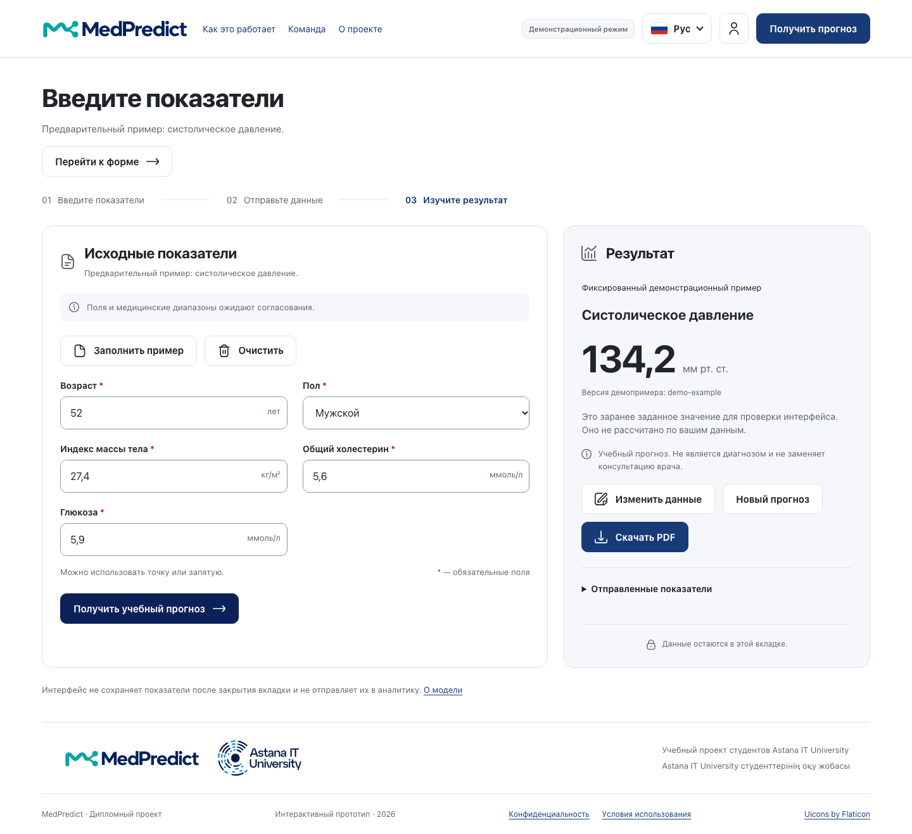

# Документация UX и прототипа MedPredict

Первая предварительная защита 24.10.2026. Осмотр исходников, Figma и локального прототипа выполнен 16.10.2026. Интерфейс в рамках этой работы не изменялся.

## 1 Назначение и источники

Документ описывает фактически существующий React-интерфейс учебного проекта по теме «Разработка интеллектуальной системы прогнозирования медицинских показателей на основе нейронных сетей». UI позволяет проверить ввод и показать фиксированный демонстрационный результат; работа трёх настоящих моделей и backend этим не подтверждается.

Предоставленный [макет Figma](https://www.figma.com/design/zOkk0fppNrBrjWDblCDwyF/Untitled?node-id=0-1) доступен через подключение Figma. На странице `0:1`, названной «MedPredict · Web / сценарии», найдены компоненты полей и кнопок, состояния ошибки/загрузки, сценарии входа/истории и передачи результата. Осмотрен экспорт главной `21:6` размером 1440×1405. Это макет, не скриншот исполняемого frontend. Названия слоёв и наличие переходов не доказывают работу серверного API.

[GitHub bsanat/MedPredict](https://github.com/bsanat/MedPredict) подтверждён подключением GitHub как публичный репозиторий с основной веткой main. Локальный checkout находится на figma-design, HEAD d55ab67451511fe9960d867a9987709aca7e8edd и содержит ранее незакоммиченные документы. Локальный origin ещё использует `juniorqazaq/MedPredict`; настройки не менялись. Ссылка на GitHub не подтверждает, что все локальные документы уже опубликованы.

Дополнительные источники: src/App.tsx, src/pages, src/components, src/hooks/usePrediction.ts, useNavigation.ts, src/styles.css, src/styles/tokens.css, docs/design/README.md, docs/api-contract.md. Изображение docs/design/concept.png в старой документации прямо обозначено как сгенерированный концепт; в настоящем документе оно не используется как доказательство работы приложения.

## 2 Экраны и навигация

| Экран и hash-маршрут | Существующее поведение | Граница готовности |
| --- | --- | --- |
| Главная `/`, секции `/how`, `/team` | Назначение, режим, три шага, команда, переход к форме | Потребность аудитории ещё не подтверждена |
| Прогноз `/predict` | Форма, проверка, ожидание/отмена, результат, исправление, очистка, PDF | Demo фиксирован; HTTP-адаптер требует настоящий сервер |
| Вход и регистрация `/login`, `/register` | Экраны и пояснение недоступности | Поля и серверные действия disabled, успешный вход отсутствует |
| Восстановление/подтверждение | `/forgot-password`, `/reset-password`, `/verify-email`, `/account/password` | Только интерфейс; email и смена пароля не работают |
| Аккаунт `/account`, `/account/delete` | Страницы и объяснение ограничения | Нет действующей сессии или удаления |
| История `/history`, `/history/...` | Состояние недоступности и переходы | Нет сохранённых прогнозов, загрузки или удаления записей |
| Сведения `/model`, `/limitations`, `/privacy`, `/terms` | Информация о модели/назначении и границах хранения | Условия backend ещё требуют согласования |

Навигация построена на hash без новой зависимости роутера. App хранит язык и форму в памяти. Переход отменяет активный запрос и скрывает результат, сохраняя введённые строки. Перезагрузка очищает ввод. Фокус переводится к заголовку целевой страницы; для секций — к соответствующему заголовку. Эти правила следует учитывать при демонстрации Back и переходов: результат не является сохранённой историей.

## 3 Основной сценарий

Главная → «Попробовать демо» → форма → ручной синтетический ввод или «Заполнить пример» → проверка → «Получить учебный прогноз» → ожидание с отменой → число, единица и ограничения → изменение/новый прогноз или PDF.

Начальная форма пустая. Пример содержит возраст 52, sex male, ИМТ 27,4, общий холестерин 5,6 и глюкозу 5,9. Эти значения служат только проверке интерфейса; их комбинация не описывает пациента и не подтверждает обоснованность набора признаков. В текущем demo ответ всегда 134,2 мм рт. ст. и версия demo-example.

В real сначала загружается и проверяется GET `/api/v1/model/info`. До валидного описания формы POST недоступен. Подписи, единицы, категории, min/max/integer задаются согласованными метаданными. Окончательный GET-контракт пока предложен frontend. Переключение M1/M2/M3 и ввод временного ряда M3 не реализованы; новая документация не приписывает эти экраны прототипу.

## 4 Формы и состояния

Поля имеют подписи и единицы; число допускает десятичную точку или запятую и преобразуется в конечное JSON number. Проверяются обязательность, тип и категории, а медицинские диапазоны используются только при наличии в конфигурации. Технически допустимое число не называется медицинской нормой.

| Состояние | Реализованное представление | Проверяемое правило |
| --- | --- | --- |
| Пустая/редактируемая форма | Исходные поля, пояснения, пустой результат | Результат не появляется до явной отправки |
| Ошибка ввода | Текст у поля, aria-invalid/aria-describedby, общий статус | Фокус первого ошибочного поля, исправление без потери остальных значений |
| Ожидание | Статус обработки, заблокированный повтор отправки, отмена | Один активный запрос; поздний ответ после отмены игнорируется |
| Успех demo | 134,2, единица, явная отметка фиксированного примера и disclaimer | Нет утверждения о вычислении нейросетью |
| Ошибка API | Понятное сообщение, сохранённый ввод, возврат к правке | Timeout/сеть/сервер/контракт не маскируются demo-успехом |
| Ошибка метаданных real | Форма недоступна, возможен повтор GET | Без валидной схемы не отправляется POST |
| Очистка | ConfirmDialog, отмена и подтверждение | Отмена сохраняет значения и возвращает фокус |
| Экспорт PDF | Подготовка, блокировка повторного клика, ошибка/повтор | Используется существующий снимок запроса и ответа, без нового POST |

API-ошибки и PDF описаны по исходникам и имеющимся тестам. Новый проход для документации проверяет demo и клиентскую валидацию; настоящий сервер и все негативные ветви заново не прогонялись.

## 5 Результат и прозрачность

Результат показывает число и единицу, поступившую версию ответа при наличии, предупреждение и раскрываемый снимок отправленных значений. Версия метаданных не подставляется вместо отсутствующей версии конкретного ответа. После редактирования результат скрывается. Доверительный интервал, график глюкозы, диагноз и рекомендации по лечению не реализованы и не заявляются.

Экспортируемый PDF содержит учебное предупреждение и demo-отметку, если режим демонстрационный. Дата документа не называется временем прогноза: текущий контракт такого времени не содержит. Пользователь сам скачивает файл, который содержит введённые им показатели. В текущей документационной проверке скачивание PDF не повторялось; исторические проверки находятся в docs/verification.md.

## 6 Адаптивность и доступность

Согласно стилям, на узких экранах рабочие панели становятся одноколоночными, затем поля выстраиваются вертикально. Есть skip-link, видимый фокус, доступные подписи, статус результата, перенос фокуса к успеху и поддержка prefers-reduced-motion. Клиентские тексты и demo доступны на русском, казахском и английском. Произвольные серверные подписи не считаются автоматически переведёнными.

Новый проход Chromium проверил отсутствие горизонтального переполнения на 1440×1050 и 390×844 в осмотренных состояниях. Он не удостоверяет полное соответствие WCAG, контраст всех компонентов, скринридер, Safari/Firefox или физические устройства. Результаты прежних проверок 320 px и трёх языков отделены в docs/verification.md.

## 7 Приватность и образовательные ограничения

Показатели не сохраняются в localStorage/sessionStorage, URL, аналитике или frontend-логах. Demo не отправляет показатели на сервер. В real данные уходят настроенному API; серверные логи, хранение и удаление ещё должны быть согласованы и проверены отдельно. Память вкладки и добровольный PDF не равны обещанию отсутствия любых копий на устройстве пользователя.

Пользователь должен понимать, что система учебная, demo фиксировано, результат не является диагнозом и не заменяет профессиональную консультацию. Три будущих модуля различаются по смыслу: M1 — числовая шкала развития; M2 — оценка измеренного САД; M3 — будущая точка ряда при утверждённом горизонте. Единый внешний стиль не позволяет объединять эти значения в клиническое заключение.

## 8 Реальные скриншоты приложения

Источник всех рисунков ниже — локальное работающее приложение, 16.10.2026, Chromium 156.0.8078.4, demo success, синтетические значения. Снимки desktop выполнены при viewport 1440×1050, mobile — 390×844; full-page высота файла может быть больше viewport. Скриншоты не являются результатом пользовательского исследования.

Рисунок 1 — Главная страница с обозначением demo и учебного назначения.

Рисунок 2 — Пустая форма и отсутствие результата до отправки.

Рисунок 3 — Пять ошибок обязательных полей после отправки; фокус установлен на возрасте.

Рисунок 4 — Фиксированные 134,2 мм рт. ст., маркировка demo и действия результата.

Рисунок 5 — Реальный экран входа; серверные действия временно недоступны.

Рисунок 6 — История не имитирует сохранённые результаты.

Рисунок 7 — Реальная панель результата при мобильном viewport 390×844. Дополнительный снимок сделан для читаемости в Word. [Полная мобильная страница с формой и результатом](screenshots/07-prediction-mobile.png) сохранена отдельно; всего в комплекте восемь снимков.

## 9 Протокол нового осмотра и расхождения с макетом

Пройден путь главная → форма → пустая отправка → пять ошибок → пример → фиксированный результат. Затем открыты отключённый вход и история и повторён результат на мобильном размере. Программно проверены title, непустой H1, отсутствие Vite overlay, ошибок/предупреждений консоли, переполнения, POST и записей web storage в этом demo-проходе. Это ограниченная проверка для фиксации прототипа; полный набор тестов не запускался повторно.

Осмотр Figma подтверждает визуальные материалы и предполагаемые сценарии, включая ещё не работающие auth/history. В макете карточка Али подписана QA Developer; актуальное поручение команды определяет его ответственность как datasets/ML. В документах используется актуальная роль; макет не редактировался. Макетные состояния успешной авторизации и истории не повышают статус реализации. Подпись о необходимости входа для real в Figma также не создаёт согласованного auth-контракта.

Готовность UX как прототипа подтверждается артефактами и локальной демонстрацией. Понятность реальным пользователям остаётся PENDING до исследования по отдельному плану. Перед защитой Санату следует проверить доступ комиссии к Figma и репозиторию и отрепетировать честное объяснение отличия demo от модели.
